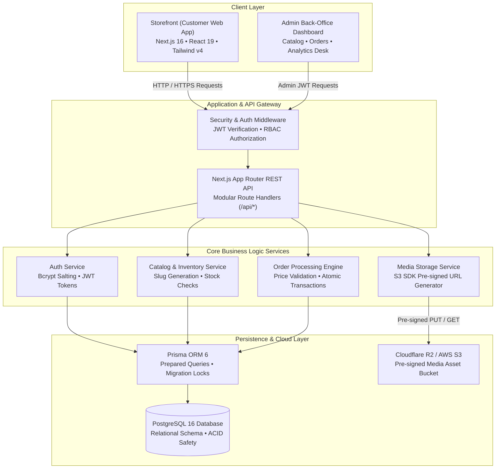
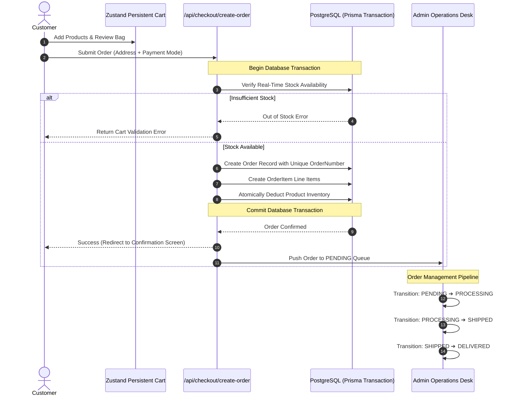
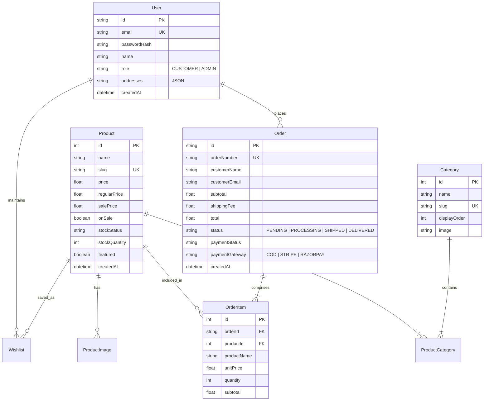

# Exora — Luxury E-Commerce & Operations Management Platform

[-000000?logo=next.js)](https://nextjs.org/)

[-3178C6?logo=typescript)](https://www.typescriptlang.org/)

---

## Executive Overview

**Exora** is an enterprise-grade luxury e-commerce and retail operations ecosystem. Designed specifically for high-end boutique brands, Exora combines an editorial, editorial-grade shopping storefront with a robust administrative back-office portal, modular REST micro-services, and relational transactional integrity.

### Primary Architectural Pillars
- **Sub-Second Performance**: Server-side rendering (SSR) and Incremental Static Regeneration (ISR) using Next.js 16 App Router.
- **Editorial Luxury Design**: Custom typography, sleek dark mode aesthetics, fluid micro-interactions, and mobile-first responsive viewports powered by Tailwind CSS v4.
- **Enterprise Operations**: Centralized administrative dashboard for multi-image product management, catalog indexing, order fulfillment pipelines, and customer relationship monitoring.
- **Transactional Integrity**: ACID-compliant PostgreSQL database managed via Prisma ORM 6 with parameterized SQL operations and foreign key cascade rules.
- **Decoupled Cloud Storage**: Direct-to-bucket media asset pipeline utilizing pre-signed URLs with Cloudflare R2 and AWS S3 SDK.

---

## Visual System Architecture

The following diagram illustrates the complete end-to-end data flow between clients, application gateways, security middleware, and persistent storage:

---

## Order Fulfillment Lifecycle

To guarantee stock consistency and eliminate race conditions during high-traffic checkout events, Exora enforces an atomic multi-stage order workflow:

---

## Core Capabilities & Engineering Features

### 1. Customer-Facing Storefront
| Feature | Technical Implementation |
| :--- | :--- |
| **Luxury Visual Identity** | Editorial serif typography, balanced negative space, and custom dark accents tailored for luxury goods. |
| **Interactive Catalog** | Real-time category filtering, slug-based deep-linking, multi-criteria sorting (Price, Newest, Featured). |
| **Product Detail Experience** | Multi-perspective thumbnail galleries, stock status badges, dynamic pricing, and quantity modifiers. |
| **Persistent Cart Engine** | Client-side reactive state managed via **Zustand 5** with localStorage hydration and real-time subtotal computation. |
| **Free Shipping Tracker** | Dynamic threshold calculation notifying customers of remaining value required for complimentary delivery (₹2,500). |
| **Seamless Checkout Flow** | Multi-stage address capture, support for Cash on Delivery (COD) and online gateways (Stripe/Razorpay ready). |
| **Customer Auth Modal** | Dual-mode authentication modal supporting Login, Account Registration, and Password Reset without page reload. |

### 2. Back-Office Admin Control Center
| Feature | Technical Implementation |
| :--- | :--- |
| **Executive Metrics Desk** | Aggregated gross sales, pending/completed order volume, inventory deficit warnings, and customer growth trends. |
| **Product Lifecycle Management** | Full CRUD operations, automatic URL slugification, category multi-tagging, and stock quantity adjustments. |
| **Pre-Signed Asset Uploads** | Direct browser-to-bucket S3 uploads bypassing web server memory limits, eliminating server upload bottlenecks. |
| **Category Structure** | Custom category display ordering, hierarchy management, and cover banner asset management. |
| **Order Processing Terminal** | Comprehensive order inspector, line-item pricing breakdowns, customer contact data, and real-time status transitions. |
| **Inquiries & Communications** | Integrated message hub for direct customer support requests originating from the storefront contact form. |

---

## Database Relational Architecture

The relational schema is engineered in PostgreSQL using Prisma ORM to ensure strict data integrity and relational constraints:

---

## REST API Specification

Exora implements a fully modular Next.js App Router API architecture:

| Endpoint | Method | Access Level | Description |
| :--- | :---: | :---: | :--- |
| `/api/auth/register` | `POST` | Public | Register customer account with bcrypt salted hashing |
| `/api/auth/login` | `POST` | Public | Authenticate credentials and issue secure signed JWT |
| `/api/auth/me` | `GET` | Authenticated | Fetch active user profile and authorization roles |
| `/api/auth/logout` | `POST` | Authenticated | Invalidate authentication session |
| `/api/auth/forgot-password` | `POST` | Public | Issue cryptographic time-expiring reset tokens |
| `/api/auth/reset-password` | `POST` | Public | Validate token signature and update password |
| `/api/products` | `GET` | Public | List products with pagination, search, and category filters |
| `/api/products` | `POST` | **Admin** | Create new catalog product record |
| `/api/products/[slug]` | `GET` | Public | Retrieve detailed product specifications and image set |
| `/api/products/[slug]` | `PUT` | **Admin** | Update product pricing, inventory, categories, and images |
| `/api/products/[slug]` | `DELETE` | **Admin** | Remove product and cascade relational cleanup |
| `/api/categories` | `GET` | Public | Retrieve catalog category hierarchy and ordering |
| `/api/cart/validate` | `POST` | Public | Real-time verification of bag prices and inventory limits |
| `/api/checkout/create-order`| `POST` | Public / Auth | Transactional order creation and atomic stock decrement |
| `/api/orders` | `GET` | Authenticated | Customer order history retrieval |
| `/api/orders/[id]` | `GET` | Authenticated | Detailed customer invoice and tracking summary |
| `/api/admin/orders` | `GET` | **Admin** | Master order pipeline filterable by status |
| `/api/admin/orders/[id]` | `PUT` | **Admin** | Update order fulfillment and payment status |
| `/api/admin/stats` | `GET` | **Admin** | Executive aggregate sales and inventory metrics |
| `/api/storage/presigned-url`| `POST` | **Admin** | Generate S3/Cloudflare R2 pre-signed upload credentials |
| `/api/wishlist` | `GET/POST` | Authenticated | Customer product bookmark management |
| `/api/contact` | `POST` | Public | Capture customer inquiry submissions |
| `/api/newsletter` | `POST` | Public | Storefront newsletter subscription capture |

---

## Technical Stack & Engineering Specifications

| Domain | Technology / Library | Role & Justification |
| :--- | :--- | :--- |
| **Storefront Architecture** | Next.js 16 (App Router) | High-performance React framework providing Hybrid SSR and ISR for SEO. |
| **Frontend Framework** | React 19 | Latest concurrent React engine with server/client component boundaries. |
| **Type Safety** | TypeScript 5 (Strict) | End-to-end interface contracts between API responses and UI state. |
| **Design System** | Tailwind CSS v4 | Next-generation CSS engine enabling fluid typography and theme tokens. |
| **State Management** | Zustand 5 | Minimalist, unopinionated client store with zero boilerplate and localStorage sync. |
| **Data Fetching** | SWR (Stale-While-Revalidate) | Automatic cache invalidation, optimistic updates, and background revalidation. |
| **Motion & Micro-interactions** | Framer Motion | Smooth page transitions, cart drawer animations, and hero carousels. |
| **Icons & Media** | Lucide React | Lightweight, tree-shakable SVG icon library. |
| **ORM & Query Engine** | Prisma 6.4.1 | Type-safe database client preventing SQL injection vulnerabilities. |
| **Database** | PostgreSQL 16 | Enterprise ACID-compliant relational database with foreign key cascading. |
| **Authentication & Cryptography** | JWT & Bcryptjs | Cryptographically signed JSON Web Tokens paired with salted password hashing. |
| **Cloud Object Storage** | Cloudflare R2 / AWS S3 SDK | High-availability asset storage with zero egress fees and pre-signed uploads. |
| **DevOps & Containerization** | Docker & pgAdmin 4 | Reproducible local PostgreSQL container environments. |

---

## Intellectual Property & Code Access

**Proprietary and Confidential.**

Copyright © 2026 **Harsh Bhayani (HarshBhayani77)**. All Rights Reserved.

> [!IMPORTANT]
> **Notice to Recruiters, Reviewers, and Hiring Teams:**  
> To protect proprietary client business logic and intellectual property, the production implementation source code is maintained in an exclusive private repository.  
> 
> Detailed architecture walkthroughs, system demonstrations, and code reviews can be arranged directly upon request.

---

## Author & Engineering Contact

**Harsh Bhayani**  
- **GitHub**: [@HarshBhayani77](https://github.com/HarshBhayani77)  
- **Email**: [harshbhayani77@gmail.com](mailto:harshbhayani77@gmail.com)  
- **Project**: Exora Luxury E-Commerce Platform
